 

  

---

## 🧠 About

**J.A.R.V.I.S** is a lightweight personal voice assistant for Android, built with **Flutter**. It is designed to run smoothly on low-end phones (target device: Redmi 8, Android 10, 4GB RAM) and understands both **Bangla** and **English**.

## 🎯 Why I Built This

I built this project to learn app development and AI by making my own voice assistant. I wanted something **free, lightweight and private** that works well on a budget phone and speaks my own language.

## ✨ Features

| | Feature | Details |
|---|---|---|
| 🔮 | Holographic Orb UI | Dark theme, neon cyan and blue, smooth animations |
| 🌐 | Bilingual | Bangla and English toggle |
| 🧠 | AI Brain | Groq (Llama 3.3) or Google Gemini 2.5 Flash |
| 🔊 | Free Voice | Android's built-in Google Text-to-Speech, unlimited |
| 🎭 | Voice Switch | Male / Female option |
| 🔐 | Secure Keys | API keys saved in encrypted storage on your own device |

## 🗺️ Roadmap

- [x] **Phase 1** - Orb UI, settings, AI chat, Google TTS, male/female voice
- [ ] **Phase 2** - Voice input with Groq Whisper, summary memory
- [ ] **Phase 3** - Google Sign-In, Drive backup, permission setup
- [ ] **Phase 4** - App allow-list, notification and accessibility automation
- [ ] **Phase 5** - Wake word "Jarvis", overlay, screenshots

## 🔒 Privacy

- API keys stay only on your device, in encrypted storage.
- This project does not collect, sell or share any personal data.
- Planned automation will work **only** for the apps the user selects.

## 👨‍💻 Developer

| | |
|---|---|
| **Name** | Sakib Ahammed Khan |
| **Country** | Bangladesh 🇧🇩 |
| **Instagram** | [@skhb7z](https://instagram.com/skhb7z) |

<b>⚖️ Legal and Disclaimer (click to open)</b>

 

- This is a personal, educational, non-commercial project.
- It uses only official, publicly available services: Flutter, Groq API, Google Gemini API and Android's built-in Google TTS. Users must use their own API keys and follow the terms of those services.
- This app is not affiliated with or endorsed by Marvel, Disney, Google, Groq or any other company. "J.A.R.V.I.S" is used only as a personal project name.
- The logo and banner in this repository are original artwork made for this project.
- The software is provided "as is", without any warranty.

## 🛠️ Build

This repository builds the APK automatically with GitHub Actions. Open the **Actions** tab, run **Build JARVIS APK**, and download the APK from **Artifacts**.

## 📄 License

MIT License. You are free to learn from this project, but please give credit.

---

⭐ If you like this project, give it a star! ⭐

